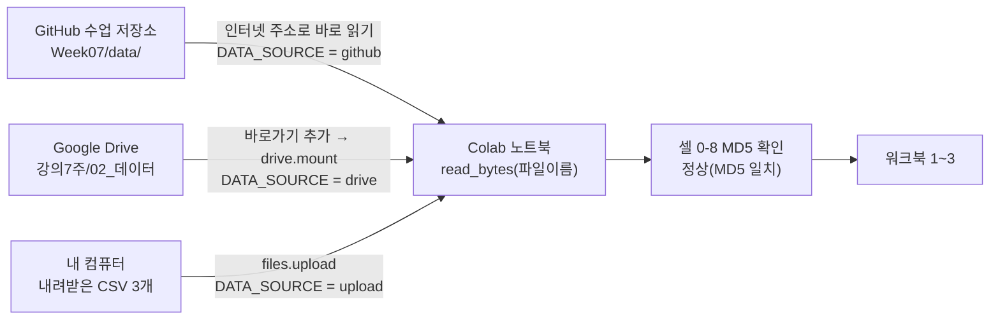

# 워크북 0 · 실습 준비 — Colab 열기와 데이터 연결

> 🎯 <b>목표</b> Colab 노트북을 열어 내 Drive에 저장하고, 도구를 설치한 뒤, **GitHub · Google Drive · 내 컴퓨터(업로드)** 중 한 곳에 있는 실습 데이터를 노트북에 연결한다. 파일 지문(MD5)으로 수업 원본과 같은 파일인지 확인한다.

<b>노트북</b> [실습본](https://colab.research.google.com/github/itlects/2026-2_ai-data/blob/main/Week07/colab/Week07_텍스트시각화_실습.ipynb) · [완성본](https://colab.research.google.com/github/itlects/2026-2_ai-data/blob/main/Week07/colab/Week07_텍스트시각화_완성.ipynb) — 이 페이지의 <b>▶ 셀 번호</b>와 노트북의 셀 번호·코드가 같습니다. 위에서부터 읽으며 같은 번호 셀을 <code>Shift+Enter</code>로 하나씩 실행하고, <b>실행 결과</b>·<b>✔ 실행 후 확인</b>과 비교합니다.

| 단계 | 셀 | 하는 일 |
| --- | --- | --- |
| 0단계. Colab 노트북 열고 내 Drive에 저장하기 | – | (읽기) |
| 1단계. 분석 도구 설치하고 가져오기 | 0-1 ~ 0-2 | 도구 설치, 도구 가져오기와 준비 |
| 2단계. 실습 데이터는 어디에 있나 — 세 곳 중 하나에서 읽기 | 0-3 ~ 0-8 | 데이터 위치 정하기, GitHub 연결 확인 (auto일 때 자동 선택), Google Drive 연결 (drive일 때만), 내 컴퓨터 파일 업로드 (upload일 때만), 어디서든 같은 방법으로 읽기 — 파일 목록표 열기, 파일 지문(MD5)으로 원본과 같은지 확인 |
| 3단계. 그림 그리는 함수 미리 만들기 | 0-9 | 막대그래프·워드클라우드 함수 |

## 0단계. Colab 노트북 열고 내 Drive에 저장하기

**Colab**은 브라우저에서 파이썬을 실행하는 Google의 무료 서비스입니다. 노트북(`.ipynb`)은 **설명 칸(텍스트 셀)** 과 **코드 칸(코드 셀)** 이 번갈아 있는 문서입니다.

1. 노션의 **실습본 Colab 열기** 링크를 누릅니다(GitHub에 있는 원본이 열림).
2. 메뉴 **파일 → Drive에 사본 저장** → 내 Drive `Colab Notebooks` 폴더에 내 사본이 생깁니다. **이제부터 사본에서 작업**합니다(원본에서 고친 내용은 저장되지 않음).
3. 코드 셀을 클릭하고 **`Shift + Enter`** → 실행되고 다음 셀로 이동합니다. 셀 왼쪽에 `[1]`처럼 실행 순서 번호가 붙습니다.
4. 왼쪽 **📁 파일** 창: 노트북이 만든 파일(`figures/`, `results/`)과 연결한 Drive가 보입니다.
5. 오래 쉬면 **런타임 연결이 끊기고 변수가 사라집니다** → `런타임 → 이전 셀 실행` 또는 위에서부터 다시 실행합니다.

| 용어 | 뜻 |
|---|---|
| 런타임 | 내 코드를 실제로 실행하는 Google의 임시 컴퓨터. 끊기면 설치·변수·파일이 사라짐 |
| 셀 실행 순서 | 위에서 아래로. 아래 셀은 위 셀이 만든 변수(`comments`, `kiwi` 등)를 씀 |
| 실습본 / 완성본 | 실습본은 `TODO` 칸의 `...`을 직접 채움. 막히면 완성본의 같은 번호 셀과 비교 |

## 1단계. 분석 도구 설치하고 가져오기

Colab에 기본으로 없는 도구 3개를 설치합니다. 처음 한 번(런타임이 새로 시작될 때마다) 실행합니다.

| 도구 | 하는 일 |
|---|---|
| `wordcloud` | 단어 빈도를 글자 크기로 그리는 워드클라우드 |
| `kiwipiepy` (Kiwi) | 한국어 **형태소 분석기** — 문장을 명사·조사·어미 등으로 나눔 |
| `koreanize-matplotlib` | 그래프의 한글이 □□□로 깨지지 않게 나눔고딕 글꼴을 설정 |

### ▶ 셀 0-1. 도구 설치

```python
!pip -q install koreanize-matplotlib wordcloud kiwipiepy   # 한글 그래프·워드클라우드·형태소 분석기 (약 30초)
```

✔ <b>실행 후 확인:</b> 오류 없이 끝나면 됩니다(출력이 없거나 경고 몇 줄). 빨간 `ERROR`가 나오면 다시 실행

<b>코드 읽기</b>

- `!pip install 이름` — `!`로 시작하면 파이썬이 아니라 컴퓨터 명령. pip = 파이썬 도구 설치 프로그램
- `-q` — 설치 과정 메시지를 짧게(quiet)

### ▶ 셀 0-2. 도구 가져오기와 준비

```python
import os, re, glob, io
from collections import Counter                 # 개수 세기 도구
import numpy as np
import pandas as pd                             # 표(DataFrame) 다루기
import matplotlib.pyplot as plt                 # 그래프
import warnings; warnings.filterwarnings("ignore")
import koreanize_matplotlib                     # import만 하면 그래프 한글이 깨지지 않음
from wordcloud import WordCloud
from kiwipiepy import Kiwi

plt.rcParams["axes.unicode_minus"] = False
# 워드클라우드는 matplotlib 글꼴 설정을 쓰지 않으므로 한글 글꼴 파일 경로를 직접 알려 준다
FONT = sorted(glob.glob(os.path.join(os.path.dirname(koreanize_matplotlib.__file__), "fonts", "NanumGothic*.ttf")))[0]
os.makedirs("figures", exist_ok=True)           # 그림 저장 폴더
os.makedirs("results", exist_ok=True)           # 결과 CSV 저장 폴더
kiwi = Kiwi()                                   # 한국어 형태소 분석기 (만들 때 몇 초 걸림)
pd.set_option("display.max_colwidth", 60)
pd.set_option("display.width", 250)                  # 표가 줄바꿈되지 않게
print("글꼴:", os.path.basename(FONT), "| 형태소 분석기 준비 완료")
```

<b>실행 결과</b>

```text
글꼴: NanumGothic.ttf | 형태소 분석기 준비 완료
```

✔ <b>실행 후 확인:</b> `글꼴: NanumGothic.ttf | 형태소 분석기 준비 완료`. `ModuleNotFoundError`면 셀 0-1을 먼저 실행

<b>코드 읽기</b>

- `import pandas as pd` — 도구(모듈)를 가져와 `pd`라는 짧은 이름으로 부름
- `from collections import Counter` — 모듈 안의 도구 하나만 꺼내 옴
- `os.makedirs("figures", exist_ok=True)` — 폴더 만들기. 이미 있으면 그냥 넘어감
- `FONT = ...` — 워드클라우드에 쓸 한글 글꼴 파일(.ttf)의 위치
- `kiwi = Kiwi()` — 형태소 분석기를 한 번 만들어 두고 아래에서 계속 사용

## 2단계. 실습 데이터는 어디에 있나 — 세 곳 중 하나에서 읽기

실습 데이터 파일은 **똑같은 파일이 세 곳**에 있습니다. 노트북은 그중 한 곳에서 읽으면 됩니다.

| 위치 | 주소 / 경로 | 언제 쓰나 | `DATA_SOURCE` |
|---|---|---|---|
| **GitHub** (수업 저장소) | `https://raw.githubusercontent.com/itlects/2026-2_ai-data/main/Week07/data/` | 평소 — 아무 준비 없이 바로 읽힘 | `"github"` |
| **Google Drive** (강의7주 `02_데이터` 폴더) | `/content/drive/MyDrive/02_데이터/` (바로가기를 추가한 위치) | 수업 중 GitHub 접속이 안 될 때 | `"drive"` |
| **내 컴퓨터** | 내려받은 CSV 파일을 Colab에 업로드 → `data/` 폴더 | 인터넷·Drive 연결이 모두 어려울 때 | `"upload"` |

기본값 `"auto"`는 **GitHub를 먼저 시도하고, 안 되면 Drive**에서 찾습니다. 대부분은 아무것도 바꾸지 않고 실행하면 됩니다.

**필요한 파일 3개**

| 파일 | 내용 |
|---|---|
| `week07_MANIFEST.csv` | 파일 목록표: 파일 이름·크기·**MD5(파일 지문)**·행 수. 노트북이 이 표로 파일이 맞는지 확인 |
| `week07_comments_300.csv` | 워크북 1: 영화 한 줄 평 300건 (NSMC, CC0) |
| `week07_news_350.csv` | 워크북 2: 연합뉴스 기사 제목 350건 (KLUE-YNAT, CC BY-SA 4.0) |

**Google Drive 데이터를 쓰려면 (처음 한 번)**
1. 강의자가 공유한 **`02_데이터`** 폴더를 엽니다 → 폴더 이름 오른쪽 클릭 → **정리 → 바로가기 추가 → 내 드라이브** 선택.
   (공유 폴더는 그대로는 Colab에서 보이지 않습니다. **내 드라이브에 바로가기**가 있어야 `/content/drive/MyDrive/02_데이터/`로 열립니다.)
2. 노트북 셀 0-3에서 `DATA_SOURCE = "drive"`로 바꾸고 셀 0-3부터 다시 실행합니다.
3. 셀 0-5가 **Drive 연결 창**을 띄웁니다 → 내 Google 계정 선택 → **허용**. 연결되면 왼쪽 📁 창에 `drive/MyDrive`가 보입니다.
4. 바로가기를 다른 폴더 안에 만들었어도 셀 0-5가 내 드라이브에서 `week07_MANIFEST.csv`를 찾아 그 폴더를 씁니다.

**내 컴퓨터 파일을 쓰려면:** Drive `02_데이터` 폴더(또는 GitHub `Week07/data/` 폴더)에서 위 파일 3개를 내려받아 → `DATA_SOURCE = "upload"` → 셀 0-6에서 3개를 함께 선택.
CSV를 엑셀로 열어 **저장하면 파일이 바뀌어** MD5 확인에서 `다른 파일`로 나옵니다. 내려받은 그대로 올립니다.

**데이터가 노트북으로 들어오는 길**



| 자료 위치 | 바로 가기 |
|---|---|
| Google Drive `02_데이터` (MANIFEST·댓글·뉴스 CSV) | [Drive 폴더 열기](https://drive.google.com/drive/folders/1mZf4ViCvmbRh4Ae3Z8loSaCH7XGmZ-cR) |
| GitHub `Week07/data/` | [GitHub 폴더 열기](https://github.com/itlects/2026-2_ai-data/tree/main/Week07/data) · [출처·정제 규칙](https://github.com/itlects/2026-2_ai-data/blob/main/Week07/data/DATA_SOURCES.md) |

### ▶ 셀 0-3. 데이터 위치 정하기

```python
DATA_SOURCE = "auto"      # "auto"(GitHub → 안 되면 Drive) | "github" | "drive" | "upload"
GITHUB_URL = "https://raw.githubusercontent.com/itlects/2026-2_ai-data/main/Week07/data/"
DRIVE_FOLDER = "/content/drive/MyDrive/02_데이터/"     # 02_데이터 바로가기를 추가한 위치
MANIFEST = "week07_MANIFEST.csv"                      # 파일 목록표 (이름·크기·MD5)
print("선택:", DATA_SOURCE)
```

<b>실행 결과</b>

```text
선택: auto
```

✔ <b>실행 후 확인:</b> `선택: auto`. Drive나 업로드를 쓰려면 첫 줄만 바꾸고 이 셀부터 다시 실행

<b>코드 읽기</b>

- `DATA_SOURCE = "auto"` — 변수에 문자열을 저장. 아래 셀들이 이 값을 보고 어디서 읽을지 정함
- `GITHUB_URL` — GitHub 원본 파일 주소의 앞부분. 뒤에 파일 이름을 붙이면 파일 주소가 됨
- `DRIVE_FOLDER` — Drive를 연결하면 내 드라이브는 `/content/drive/MyDrive/` 아래에 보임

### ▶ 셀 0-4. GitHub 연결 확인 (auto일 때 자동 선택)

```python
import urllib.request

def github_ok():
    """GitHub에서 파일 목록표를 열어 보고 되면 True"""
    try:
        urllib.request.urlopen(GITHUB_URL + MANIFEST, timeout=15)
        return True
    except Exception as e:
        print("GitHub 접속 실패:", type(e).__name__)
        return False

if DATA_SOURCE == "auto":
    DATA_SOURCE = "github" if github_ok() else "drive"
print("데이터 위치:", DATA_SOURCE)
```

<b>실행 결과</b>

```text
데이터 위치: github
```

✔ <b>실행 후 확인:</b> `데이터 위치: github`. GitHub가 안 되면 `GitHub 접속 실패 …` 뒤에 `drive`로 바뀜

<b>코드 읽기</b>

- `def github_ok():` — 함수 정의. 몸통은 4칸 들여쓰기
- `try: … except Exception as e:` — 실행해 보고 오류가 나면 멈추지 않고 except 부분을 실행
- `urllib.request.urlopen(주소)` — 인터넷 주소의 파일을 엶
- `A if 조건 else B` — 조건이 참이면 A, 아니면 B

### ▶ 셀 0-5. Google Drive 연결 (drive일 때만)

```python
if DATA_SOURCE == "drive":
    from google.colab import drive
    drive.mount("/content/drive")                         # 처음 한 번: 계정 선택 → 허용
    if not os.path.exists(DRIVE_FOLDER + MANIFEST):       # 바로가기를 다른 곳에 만든 경우 → 찾기
        hits = [p for d in range(0, 6)
                for p in glob.glob("/content/drive/MyDrive/" + "*/" * d + MANIFEST)]
        if not hits:
            raise FileNotFoundError("내 드라이브에서 week07_MANIFEST.csv를 찾지 못했습니다. "
                                    "공유받은 02_데이터 폴더를 '바로가기 추가 → 내 드라이브' 했는지 확인하세요.")
        DRIVE_FOLDER = os.path.dirname(hits[0]) + "/"
    print("Drive 폴더:", DRIVE_FOLDER)
    print(sorted(os.listdir(DRIVE_FOLDER)))
else:
    print("Drive 연결은 건너뜀 (DATA_SOURCE =", DATA_SOURCE + ")")
```

<b>실행 결과</b>

```text
Drive 연결은 건너뜀 (DATA_SOURCE = github)
```

✔ <b>실행 후 확인:</b> GitHub를 쓰면 `Drive 연결은 건너뜀`. Drive를 쓰면 폴더 경로와 파일 목록(`week07_MANIFEST.csv` 등)이 보여야 함

<b>코드 읽기</b>

- `drive.mount("/content/drive")` — 내 Google Drive를 Colab의 `/content/drive` 폴더에 붙임(마운트)
- `os.path.exists(경로)` — 파일이 있으면 True
- `glob.glob("…/*/…/파일")` — `*` 자리에 아무 폴더 이름이 와도 되는 경로를 모두 찾음 (여기서는 0~5단계 깊이)
- `raise FileNotFoundError(…)` — 더 진행할 수 없으니 알아보기 쉬운 메시지와 함께 멈춤
- `os.listdir(폴더)` — 폴더 안 파일 이름 목록

🔁 <b>직접 바꿔 보기:</b> 왼쪽 📁 창에서 `drive/MyDrive/02_데이터` 폴더를 오른쪽 클릭 → **경로 복사** → `DRIVE_FOLDER`에 붙여 넣으면 직접 지정할 수 있습니다(끝에 `/`를 붙임).

### ▶ 셀 0-6. 내 컴퓨터 파일 업로드 (upload일 때만)

```python
if DATA_SOURCE == "upload":
    from google.colab import files
    os.makedirs("data", exist_ok=True)
    print("week07_MANIFEST.csv, week07_comments_300.csv, week07_news_350.csv 세 파일을 선택하세요.")
    for name, content in files.upload().items():          # 파일 선택 창이 열림
        open("data/" + name, "wb").write(content)
    print(sorted(os.listdir("data")))
else:
    print("업로드는 건너뜀 (DATA_SOURCE =", DATA_SOURCE + ")")
```

<b>실행 결과</b>

```text
업로드는 건너뜀 (DATA_SOURCE = github)
```

✔ <b>실행 후 확인:</b> 평소에는 `업로드는 건너뜀`. 업로드를 쓰면 세 파일 이름이 출력되어야 함

<b>코드 읽기</b>

- `files.upload()` — 파일 선택 창을 열고, 고른 파일을 {이름: 내용} 사전으로 돌려줌
- `open(경로, "wb").write(내용)` — 내용을 그대로(바이트) 파일로 저장. w=쓰기, b=바이너리

### ▶ 셀 0-7. 어디서든 같은 방법으로 읽기 — 파일 목록표 열기

```python
def read_bytes(name):
    """선택한 위치에서 파일 내용을 그대로(bytes) 읽어 온다"""
    if DATA_SOURCE == "github":
        return urllib.request.urlopen(GITHUB_URL + name, timeout=120).read()
    if DATA_SOURCE == "drive":
        return open(DRIVE_FOLDER + name, "rb").read()
    if DATA_SOURCE == "upload":
        return open("data/" + name, "rb").read()
    return open(os.path.join(DATA_SOURCE, name), "rb").read()   # 폴더 경로를 직접 적은 경우

manifest = pd.read_csv(io.BytesIO(read_bytes(MANIFEST)), encoding="utf-8-sig")
manifest[["file", "bytes", "rows", "note"]]
```

<b>실행 결과</b>

```text
                      file    bytes    rows                                                   note
0  week07_comments_300.csv    32278     300             워크북 1 입력: 네이버 영화 140자평(NSMC) 긍정 150·부정 150
1      week07_news_350.csv    71235     350                워크북 2 입력: 연합뉴스 제목(KLUE-YNAT) 7개 분야 × 50
2      nsmc_ratings.txt.gz  8282350  200000  댓글 원자료 미러, 압축 해제 MD5=f1f2772629b775ac39a6344e95a2c9a8
3   ynat_titles_all.csv.gz  2353363   45678        뉴스 제목 전체본(guid·category·title·date·url), 확장 과제용
```

✔ <b>실행 후 확인:</b> 4행 표: 댓글 CSV 300행, 뉴스 CSV 350행, 원자료 미러 2개

<b>코드 읽기</b>

- `def read_bytes(name):` — 어디에 있든 `read_bytes("파일이름")` 한 줄로 읽게 해 주는 함수. 아래 워크북은 이 함수만 씀
- `io.BytesIO(내용)` — 메모리에 있는 내용을 파일처럼 다루게 해 줌 → `read_csv`가 읽을 수 있음
- `encoding="utf-8-sig"` — 한글 CSV 인코딩. 엑셀에서 연 CSV도 한글이 깨지지 않게 저장한 형식
- `manifest[["file", …]]` — 표에서 여러 열만 골라 보기 (대괄호 두 겹)

### ▶ 셀 0-8. 파일 지문(MD5)으로 원본과 같은지 확인

```python
import hashlib

def check_file(name):
    """파일을 읽어 MD5를 계산하고 목록표의 값과 비교한다. 같으면 수업 원본과 똑같은 파일"""
    data = read_bytes(name)
    expected = manifest.set_index("file").loc[name, "md5"]
    ok = hashlib.md5(data).hexdigest() == expected
    print(f"{name:26s} {len(data):>7,} bytes → {'정상(MD5 일치)' if ok else '⚠ 다른 파일! 강의자에게 알리세요'}")
    return data

for name in ["week07_comments_300.csv", "week07_news_350.csv"]:
    check_file(name)
```

<b>실행 결과</b>

```text
week07_comments_300.csv     32,278 bytes → 정상(MD5 일치)
week07_news_350.csv         71,235 bytes → 정상(MD5 일치)
```

✔ <b>실행 후 확인:</b> 두 줄 모두 `정상(MD5 일치)`. GitHub·Drive·업로드 어디서 읽어도 같아야 하며, 그래야 아래 기대값이 똑같이 나옴

<b>코드 읽기</b>

- `hashlib.md5(data).hexdigest()` — 파일 내용으로 32자리 지문을 계산. 한 글자만 달라도 완전히 다른 값
- `manifest.set_index("file").loc[name, "md5"]` — 목록표에서 그 파일 행의 md5 값 찾기
- `f"{name:26s} {len(data):>7,}"` — f-문자열: 26칸 맞춤, 오른쪽 정렬 7칸에 천 단위 쉼표

## 3단계. 그림 그리는 함수 미리 만들기

워크북 1·2에서 막대그래프와 워드클라우드를 여러 번 그립니다. 같은 코드를 반복하지 않도록 **함수**로 만들어 둡니다.
**빈도(Counter)** 만 넣으면 그림을 그리고 `figures/` 폴더에 PNG로 저장합니다.

- **막대그래프**: 상위 단어의 **정확한 개수와 순위**를 비교할 때
- **워드클라우드**: 글자 크기 = 빈도. **한눈에 보는 인상**. 색·위치는 의미 없음

### ▶ 셀 0-9. 막대그래프·워드클라우드 함수

```python
def bar_top(counter, title, fname, n=20, color="#4C72B0"):
    """상위 n개 단어 가로 막대그래프"""
    words, counts = zip(*counter.most_common(n))
    fig, ax = plt.subplots(figsize=(7, 0.32 * n + 1))
    ax.barh(words[::-1], counts[::-1], color=color)        # 1위가 맨 위에 오도록 뒤집기
    for y, v in enumerate(counts[::-1]):
        ax.text(v + 0.3, y, str(v), va="center", fontsize=9)
    ax.set_title(title); ax.set_xlabel("빈도(등장 횟수)")
    ax.spines[["top", "right"]].set_visible(False)
    fig.tight_layout(); fig.savefig(f"figures/{fname}", dpi=150); plt.show()

def make_wc(counter, colormap="viridis", max_words=80):
    """빈도 → 워드클라우드 (random_state 고정: 실행할 때마다 배치가 같음)"""
    return WordCloud(font_path=FONT, width=900, height=500, background_color="white",
                     colormap=colormap, max_words=max_words, random_state=42,
                     prefer_horizontal=0.9).generate_from_frequencies(counter)

def show_wc(counter, title, fname, colormap="viridis"):
    fig, ax = plt.subplots(figsize=(9, 5))
    ax.imshow(make_wc(counter, colormap)); ax.axis("off"); ax.set_title(title)
    fig.tight_layout(); fig.savefig(f"figures/{fname}", dpi=150); plt.show()

bar_top(Counter({"사과": 5, "배": 3, "포도": 2}), "함수 시험: 막대그래프", "test_bar.png", n=3)
```

✔ <b>실행 후 확인:</b> 사과 5·배 3·포도 2 막대그래프가 한글로 보이면 준비 끝. □□□로 보이면 셀 0-2를 다시 실행

<b>코드 읽기</b>

- `def 함수(입력, n=20):` — `n=20`은 기본값. 넣지 않으면 20
- `counter.most_common(n)` — 많이 나온 순서로 (단어, 개수) n개
- `zip(*목록)` — [(단어, 개수), …]를 (단어들), (개수들) 두 묶음으로 나눔
- `[::-1]` — 순서 뒤집기
- `WordCloud(font_path=FONT, …).generate_from_frequencies(counter)` — 단어별 개수로 워드클라우드를 만듦. 한글은 font_path가 꼭 필요
- `fig.savefig("figures/…")` — 그림을 파일로 저장 → 왼쪽 📁 창 `figures/`에서 확인

## 정리

**워크북 0 정리:** 데이터 위치 `github`(또는 drive/upload), 두 파일 `정상(MD5 일치)`, 시험 막대그래프가 한글로 보이면 워크북 1로 넘어갑니다.

| 문제 | 원인 | 해결 |
|---|---|---|
| `NameError: name 'pd' is not defined` | 위 셀을 실행하지 않고 아래 셀부터 실행 | 셀 0-1부터 차례로 다시 실행 |
| `FileNotFoundError … week07_MANIFEST.csv` | Drive에 `02_데이터` 바로가기가 없음 | 2단계 안내대로 바로가기 추가 후 셀 0-5 다시 실행 |
| `⚠ 다른 파일!` | 파일을 엑셀로 열어 저장했거나 다른 파일 | 원본을 다시 내려받기(엑셀로 저장하지 않기) |
| 그래프 글자가 □□□ | 글꼴 설정 전 그림을 그림 | 셀 0-2를 다시 실행 |
| 오래 쉬었더니 변수가 없음 | 런타임 연결 끊김 | `런타임 → 이전 셀 실행` |
