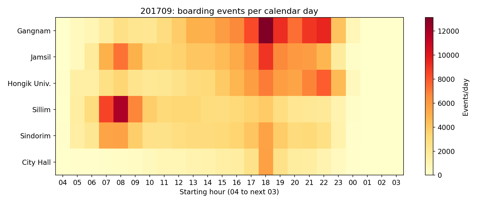

# Week10 교통 데이터의 시각화

동서울대학교 인공지능과 데이터 활용, 2026-2학기. 기본 120분, 선택 AI 심화 15~20분.

## 바로 시작
- [학생 워크북 Colab 열기](https://colab.research.google.com/github/itlects/2026-2_ai-data/blob/main/Week10/notebooks/Week10_Student_Workbook.ipynb)
- [실행 결과가 있는 완성 예제 Colab 열기](https://colab.research.google.com/github/itlects/2026-2_ai-data/blob/main/Week10/notebooks/Week10_Completed_Example.ipynb)
- [강의 노션](https://app.notion.com/p/40eb2e6bf80780d0a91be75b4a596677)
- [Drive 전체 자료](https://drive.google.com/drive/folders/1QAzK6zvNbnmODChS9MrjmB9AnERzdPgn)
- [CSV Drive 제공본](https://drive.google.com/file/d/1XvhVGkqu-oswxe6zbXM2Dd1S3kZoL7Rw/view)

Colab에서 Drive에 사본을 저장하고 위에서 아래로 실행합니다. 기본 수업은 1~7단계 다음 9단계, 추가 실습은 8단계를 포함합니다. 자동 CSV 읽기가 실패하면 제공 CSV 1개를 업로드합니다. API 키가 필요 없습니다.

## 자료
| 경로 | 내용 |
|---|---|
| data/ | 선택 원자료와 분석용 tidy CSV |
| notebooks/ | 전체 코드가 있는 학생 워크북과 실행 결과 완성 예제 |
| materials/Lecture_Notes.md | 개념·용어·수업 흐름·평가 |
| materials/Student_Tutorial.md | 학생이 순서대로 실행할 전체 코드 |
| materials/AI_SERVICE_COMPARISON.md | 실제 AI 서비스 비교 절차와 기록표 |
| materials/SOURCES.md | 원출처, 보관본 경유, 가공 범위와 제한 |
| materials/DATA_DICTIONARY.md | 열 정의·집계 단위 |
| materials/Instructor_Guide.md | 교수자 진행·기준 결과·오류 대응 |
| materials/validation.json | 실행·합계 검증 기록 |
| results/ | 기본 조건의 결과 그림, 요약과 예측 결과 예시 |

## 데이터 범위
2017년 2호선 6역, 12개월의 역사 보관본에서 72행을 선택했고 24시간 세로 변환 후 1,728행입니다. 공식 서울시 자료를 수집한 공개 저장소 보관본을 경유했으며 공식 원본과의 전수 대조는 수행하지 못했습니다. 최신 현황, 특정 평일, 실제 열차 탑승률을 나타내지 않습니다. 상세 출처는 SOURCES.md에 있습니다.

## 결과 미리보기

## 실행 환경과 확인 범위
Python 3, pandas, numpy, matplotlib, scikit-learn. Colab 기본 CPU 런타임을 대상으로 작성했습니다. 로컬 Python에서 9개 코드 셀과 선택 심화를 실행하고, 다른 월·역 조건의 집계도 검사했습니다. 실제 Google Colab 서버에서 실행한 것은 아닙니다. 교통 공식 사이트/API 연결은 환경에서 실패하여 고정 보관본을 사용합니다.

제출: 본인 답변을 채운 ipynb와 워크북에서 생성하는 ZIP. 실제 서비스 조회 실패 시 매뉴얼 기반 비교도 가능합니다. 예측 실습의 MAE는 수업 내부 이용량 예측 결과이며 공식 서비스 정확도가 아닙니다.
