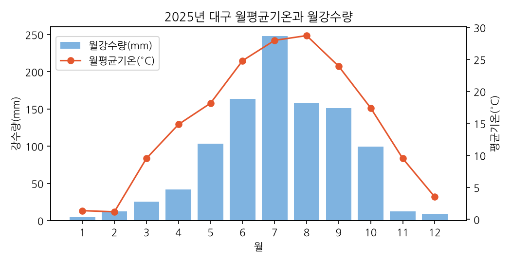
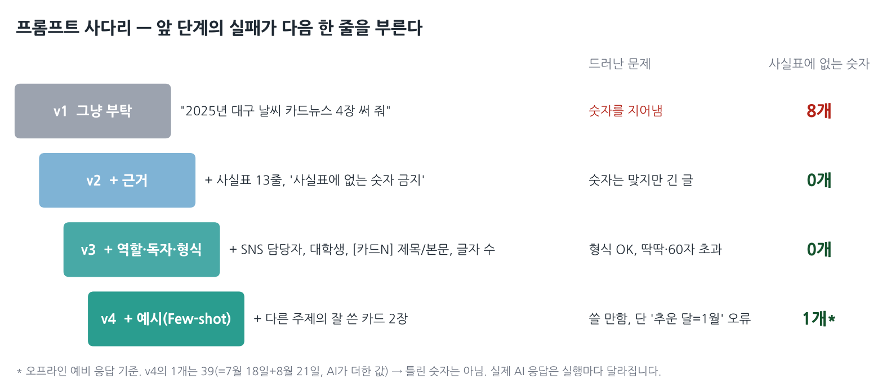
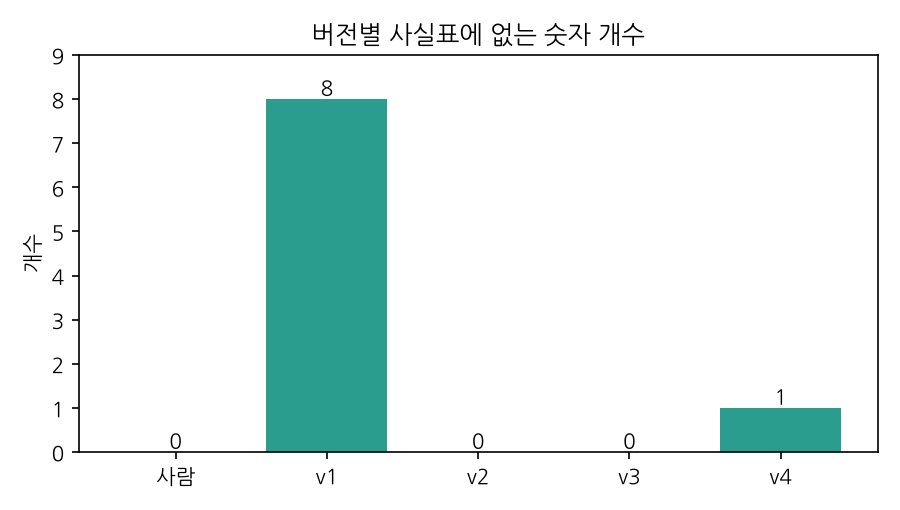

<callout icon="📒" color="blue_bg">
<b>워크북 1 — 사실표 만들기와 프롬프트 v1→v4 (0~8단계 · 20~78분)</b>

- 학생: [학생 워크북 Colab](https://colab.research.google.com/drive/1yfC_Y1NFxIZgmNFaaBpeaYSPRuOpzIUy) → `파일 → Drive에 사본 저장` 후 실행
- 강의자: [강의자 시연 완성본 Colab](https://colab.research.google.com/drive/10l9irpctHZoZUQ6pyWyWYyI0VFUprkOq) (실행 결과·예시 답 저장본)
- 두 노트북은 서로 다른 파일입니다. 강의자가 실행해도 학생 노트북에는 영향이 없습니다.
- 이 페이지의 코드는 노트북 코드와 같습니다. '실행 결과 예시'는 오프라인 예비 응답 기준이며, 실제 AI 응답은 실행할 때마다 달라집니다.
</callout>

<callout icon="🧑‍🏫" color="gray_bg">
<b>같이 치기 · 20분</b> 강사 화면 = 강의자 Colab. 한 셀씩 함께 실행합니다. 0-1 셀은 길어서 설명 없이 실행만 합니다.
</callout>

## 0단계. 실습 준비 (3분)
그래프·카드에 한글이 보이도록 한글 폰트를 설치하고, **AI 연결**을 확인합니다.

| 도구 | 하는 일 |
|---|---|
| `pandas` | 표(DataFrame) 데이터 읽기·계산 |
| `matplotlib` + `koreanize_matplotlib` | 그래프·카드 이미지 그리기 + 한글 폰트 |
| `google.colab.ai` | Colab에 들어 있는 생성형 AI(Gemini). **API 키 없이** `ai.generate_text(프롬프트)` 한 줄로 글을 생성 |
| `re` | 글 속에서 숫자를 찾아내는 정규표현식 |

`ask_ai(버전, 프롬프트)` 함수는 다음 순서로 응답을 가져옵니다.
1. 🔧 붙여넣기 칸(`PASTE`)에 직접 붙여 넣은 응답이 있으면 그것을 씁니다(Gemini 웹 등에서 받은 결과).
2. 없으면 Colab AI에 요청합니다.
3. Colab AI를 쓸 수 없으면(사용량 한도 등) **오프라인 예비 응답**을 쓰고 ⚠️로 알려 줍니다. 실습은 끊기지 않습니다.

✅ **확인:** `준비 완료`와 함께 `✔ Colab AI 연결됨` 또는 `⚠️ 오프라인 예비 응답 모드`가 출력됩니다.

```python
import subprocess, sys
try:
    import koreanize_matplotlib            # 그래프 한글 폰트
except ImportError:
    subprocess.run([sys.executable, '-m', 'pip', 'install', '-q', 'koreanize-matplotlib'], check=False)
    try:
        import koreanize_matplotlib
    except ImportError:
        print('⚠️ 한글 폰트 설치 실패: 그림의 한글이 네모로 보일 수 있지만 실습은 계속할 수 있습니다.')

import re, json, textwrap, random, shutil, datetime
from pathlib import Path
import pandas as pd
import matplotlib.pyplot as plt
try:
    from IPython.display import display, Image
except ImportError:
    display = print

plt.rcParams['axes.unicode_minus'] = False
OUT = Path('week13_outputs')
OUT.mkdir(exist_ok=True)

# ── AI 연결 ─────────────────────────────────────────────
try:
    from google.colab import ai
    AI_OK = True
except Exception:
    ai, AI_OK = None, False
print('준비 완료 · pandas', pd.__version__)
print('✔ Colab AI 연결됨' if AI_OK else '⚠️ 오프라인 예비 응답 모드 (Colab이 아니거나 AI를 쓸 수 없음)')
```

<b>실행 결과 예시</b> (강의자 완성본, 오프라인 예비 응답 기준)

```plain text
준비 완료 · pandas 3.0.5
⚠️ 오프라인 예비 응답 모드 (Colab이 아니거나 AI를 쓸 수 없음)
```

### 0-1. 응답 가져오기 함수와 예비 응답 (실행만 하세요)
이 셀은 `ask_ai()` 함수와 오프라인 예비 응답을 준비합니다. 내용을 읽지 않아도 됩니다.

✅ **확인:** `ask_ai 준비 완료` 출력

<toggle>
코드 보기 (예비 응답 4개 + ask_ai 함수, 길어서 접어 둠)

```python
OFFLINE = {
 "v1": "[카드1] 제목: 2025 대구 날씨 결산 ☀️ / 본문: 연평균 16.1°C, 대프리카의 뜨거웠던 1년을 돌아봐요!\n[카드2] 제목: 역대급 폭염 / 본문: 8월 2일 낮 최고 39.8°C! 폭염 41일, 열대야도 30일이나 이어졌어요.\n[카드3] 제목: 장마와 집중호우 / 본문: 장마철에만 520mm, 1년 강수량은 1,180mm를 기록했어요.\n[카드4] 제목: 겨울도 매서웠다 / 본문: 1월 최저 -12.3°C까지! 2026년에도 건강 챙기세요.",
 "v2": "2025년 대구의 날씨를 정리해 보면, 연평균기온은 15.2°C였습니다. 가장 더웠던 날은 7월 7일로 최고기온이 37.4°C까지 올라갔고, 최고기온이 33°C 이상인 폭염일은 모두 48일이었습니다. 특히 7월에 18일, 8월에 21일로 여름 두 달에 폭염이 집중되었습니다. 가장 더운 달은 평균 28.7°C를 기록한 8월이었습니다.\n\n비는 1년 동안 1,029.0mm가 내렸고, 7월에만 248.0mm가 내려 가장 많았습니다. 7월 17일에는 하루에 102.3mm의 비가 쏟아지기도 했습니다.\n\n겨울에는 1월 10일 최저기온이 -10.6°C까지 내려갔으며, 월평균으로는 2월이 1.2°C로 가장 추운 달이었습니다. 이처럼 2025년 대구는 무더운 여름과 추운 겨울이 뚜렷한 한 해였습니다.",
 "v3": "[카드1] 제목: 2025 대구 날씨 결산 / 본문: 2025년 대구의 1년 날씨를 기상청 관측자료로 정리했습니다.\n[카드2] 제목: 폭염일 48일 / 본문: 최고기온 33°C 이상인 폭염일은 48일이었습니다. 가장 더운 날은 7월 7일로 최고기온 37.4°C를 기록했으며 8월 평균기온은 28.7°C였습니다.\n[카드3] 제목: 연강수량 1,029mm / 본문: 연강수량은 1,029.0mm이며 7월이 248.0mm로 가장 많았습니다.\n[카드4] 제목: 가장 추운 날 1월 10일 / 본문: 최저기온 -10.6°C. 가장 추운 달은 2월(평균 1.2°C). 출처: 기상청 ASOS 대구",
 "v4": "[카드1] 제목: 2025 대구, 숫자로 본 1년 / 본문: 덥고, 젖고, 얼었던 대구의 2025년을 4장에 담았어요\n[카드2] 제목: 폭염 48일, 37.4°C / 본문: 33°C를 넘긴 날만 48일. 그중 39일이 7~8월에 몰렸어요. 정점은 7월 7일!\n[카드3] 제목: 7월에만 비 248mm / 본문: 1년 비 1,029mm 중 7월이 최다. 7월 17일엔 하루 102.3mm가 쏟아졌어요\n[카드4] 제목: 최저 -10.6°C의 겨울 / 본문: 1월 10일이 가장 추웠고, 가장 추운 달도 1월이었어요. 자료: 기상청 ASOS 대구"
}

PASTE = {'v1': '', 'v2': '', 'v3': '', 'v4': ''}   # 🔧 다른 AI 결과를 붙여 넣을 때만 사용(4-1 참고)
prompts, responses, sources = {}, {}, {}

def ask_ai(version, prompt):
    """프롬프트를 AI에 보내고 응답 글을 돌려준다(붙여넣기 → Colab AI → 예비 응답 순)."""
    prompts[version] = prompt
    if PASTE.get(version, '').strip():
        text, src = PASTE[version].strip(), '붙여넣기'
    else:
        text, src = None, None
        if AI_OK:
            try:
                text, src = str(ai.generate_text(prompt)).strip(), 'Colab AI(Gemini)'
            except Exception as e:
                print('⚠️ Colab AI 요청 실패:', type(e).__name__, '→ 예비 응답 사용')
        if not text:
            text, src = OFFLINE[version], '오프라인 예비 응답'
    responses[version], sources[version] = text, src
    print(f'── {version} 응답 [{src}] ──')
    print(text)
    return text

print('ask_ai 준비 완료')
```
</toggle>

<b>실행 결과 예시</b> (강의자 완성본, 오프라인 예비 응답 기준)

```plain text
ask_ai 준비 완료
```

### 0-2. 내 정보 ✍️
제출 파일 이름과 블라인드 비교 순서에 쓰입니다.

```python
STUDENT_ID = ''   # ✍️ 학번 또는 이름 (예: '2025123')
STUDENT_ID = STUDENT_ID.strip() or 'student'
print('제출자:', STUDENT_ID)
```

<toggle>
✍️ 강의자 예시 답 (완성본 노트북의 값)

```python
STUDENT_ID = '강의자예시'   # ✍️ 학번 또는 이름 (예: '2025123')
```
</toggle>

<b>실행 결과 예시</b> (강의자 완성본, 오프라인 예비 응답 기준)

```plain text
제출자: 강의자예시
```

## 1단계. 2025년 대구 날씨 데이터 불러오기 (3분)
11주차에 쓴 **기상청 ASOS 대구(143) 시간자료**에서 2025년 1년치를 **하루 단위로 묶은** 파일입니다(11주차 3단계와 같은 방법).

| 열 | 뜻 |
|---|---|
| `날짜` | 2025-01-01 ~ 2025-12-31 |
| `평균기온`·`최고기온`·`최저기온` | 그날 정시 관측 24개의 평균·최댓값·최솟값(°C) |
| `일강수량` | 그날 24시간 강수량의 합(mm) |

- 파일 위치: [Google Drive 01_실습데이터](https://drive.google.com/drive/folders/1pjKqStaatkeP8X8NvB6SxpMZXp0byMDe) · 원본: [기상청 기상자료개방포털](https://data.kma.go.kr/data/grnd/selectAsosRltmList.do?pgmNo=36)
- Drive가 안 되면 수업 GitHub 사본으로, 그것도 안 되면 업로드 창으로 자동 전환됩니다.

✅ **확인:** `✔ [Google Drive] daegu_2025_daily.csv (365, 5)`

```python
DRIVE_ID = '1WmAEujrcioJowxMTbzWc8mFCfAXrogAt'
NAME = 'daegu_2025_daily.csv'
BACKUP = 'https://raw.githubusercontent.com/itlects/2026-2_ai-data/main/week13/data/' + NAME          # Drive 실패 시 백업
Path('week13_data').mkdir(exist_ok=True)
path = Path('week13_data') / NAME

def read_ok(src):
    try:
        df = pd.read_csv(src, parse_dates=['날짜'])
        return df if df.shape == (365, 5) else None
    except Exception:
        return None

daily = read_ok(path) if path.exists() else None   # ⓪ 이미 받은 파일(다시 실행할 때)
if daily is not None:
    print('✔ [이미 받은 파일]', NAME, daily.shape)
else:
    try:                               # ① Google Drive
        import gdown
        gdown.download(id=DRIVE_ID, output=str(path), quiet=True)
        daily = read_ok(path)
        if daily is not None:
            print('✔ [Google Drive]', NAME, daily.shape)
    except Exception as e:
        print('  Drive 내려받기 실패:', type(e).__name__)
if daily is None:                      # ② 백업: 수업 GitHub
    daily = read_ok(BACKUP)
    if daily is not None:
        print('✔ [GitHub 백업]', NAME, daily.shape)
if daily is None:                      # ③ 직접 업로드
    from google.colab import files
    print('Drive 01_실습데이터에서 CSV를 내려받아 업로드하세요.')
    up = files.upload()
    daily = read_ok(list(up)[0])
    print('✔ [업로드]', daily.shape)

daily = daily.set_index('날짜')
display(daily.head(3))
```

<b>실행 결과 예시</b> (강의자 완성본, 오프라인 예비 응답 기준)

자료 제작 환경에서는 Drive 접속이 막혀 GitHub 백업으로 읽었습니다. Colab에서는 보통 `✔ [Google Drive] daegu_2025_daily.csv (365, 5)`가 나옵니다.

```plain text
  Drive 내려받기 실패: ProxyError
✔ [GitHub 백업] daegu_2025_daily.csv (365, 5)
            평균기온  최고기온  최저기온  일강수량
날짜                                
2025-01-01   2.9   9.6  -3.2   0.0
2025-01-02   2.8   9.8  -3.6   0.0
2025-01-03   1.7   4.4  -0.8   0.0
```

<callout icon="🚩" color="red_bg">
<b>CP1 · 25분</b> `✔ [Google Drive] daegu_2025_daily.csv (365, 5)`(또는 GitHub 백업) + `✔ Colab AI 연결됨` 또는 `⚠️ 오프라인 예비 응답 모드`. 막히면 `런타임 → 모두 실행`.
</callout>

<callout icon="🧑‍🏫" color="gray_bg">
<b>같이 치기 · 25분</b> 표 아래 계산 세 줄(idxmax, sum, groupby)만 짚고 실행합니다.
</callout>

## 2단계. 데이터에서 '사실' 뽑기 (8분)
카드뉴스에 들어갈 숫자는 **AI가 아니라 데이터가** 정합니다. pandas로 1년치 365일에서 핵심 사실을 계산해 **사실표**를 만듭니다. 이 사실표가 오늘의 '정답지'입니다.

| 코드 | 하는 일 |
|---|---|
| `daily['최고기온'].idxmax()` | 최고기온이 가장 높은 **날짜** |
| `(daily['최고기온'] >= 33).sum()` | 조건을 만족하는 날 **개수** (폭염일: 최고기온 33°C 이상) |
| `daily.groupby(daily.index.month)` | **월별로** 묶어 평균·합계 계산 |

✅ **확인:** 사실표 13줄 — 연평균 **15.2°C**, 가장 더운 날 **7월 7일 37.4°C**, 가장 추운 날 **1월 10일 −10.6°C**, 폭염일 **48일**(7월 18일·8월 21일), 가장 더운 달 **8월 28.7°C**, 가장 추운 달 **2월 1.2°C**, 연강수량 **1,029.0mm**, 비가 가장 많은 달 **7월 248.0mm**, 하루 최다 **7월 17일 102.3mm**. 그림 `fig_monthly.png` 저장.

```python
def md_(d):                                    # Timestamp → '7월 7일'
    return f'{d.month}월 {d.day}일'

month = daily.groupby(daily.index.month).agg(평균기온=('평균기온', 'mean'),
                                             강수량=('일강수량', 'sum'),
                                             폭염일=('최고기온', lambda s: int((s >= 33).sum())))
hot, cold, wet = daily['최고기온'].idxmax(), daily['최저기온'].idxmin(), daily['일강수량'].idxmax()
fact_rows = [
    ('연평균기온',          f"{daily['평균기온'].mean():.1f}°C"),
    ('가장 더운 날',        f"{md_(hot)} (최고 {daily.loc[hot, '최고기온']:.1f}°C)"),
    ('가장 추운 날',        f"{md_(cold)} (최저 {daily.loc[cold, '최저기온']:.1f}°C)"),
    ('폭염일(최고 33°C 이상)', f"{int((daily['최고기온'] >= 33).sum())}일"),
    ('7월 폭염일',          f"{month.loc[7, '폭염일']}일"),
    ('8월 폭염일',          f"{month.loc[8, '폭염일']}일"),
    ('가장 더운 달',        f"{month['평균기온'].idxmax()}월 (평균 {month['평균기온'].max():.1f}°C)"),
    ('가장 추운 달',        f"{month['평균기온'].idxmin()}월 (평균 {month['평균기온'].min():.1f}°C)"),
    ('연강수량',            f"{daily['일강수량'].sum():,.1f}mm"),
    ('비가 가장 많은 달',   f"{month['강수량'].idxmax()}월 ({month['강수량'].max():.1f}mm)"),
    ('하루 강수량 최다',    f"{md_(wet)} ({daily.loc[wet, '일강수량']:.1f}mm)"),
    ('관측 지점',           '기상청 ASOS 대구(143), 정시 관측'),
    ('기간',                '2025년 1월 1일 ~ 12월 31일'),
]
facts = pd.DataFrame(fact_rows, columns=['항목', '값'])
FACT_TEXT = '\n'.join(f'- {a}: {b}' for a, b in facts.values)   # 프롬프트에 넣을 글
display(facts)

# 카드에도 쓸 월별 그림
fig, ax1 = plt.subplots(figsize=(7, 3.6))
ax1.bar(month.index, month['강수량'], color='#7fb3e0', label='월강수량(mm)')
ax1.set(xlabel='월', ylabel='강수량(mm)', xticks=range(1, 13))
ax2 = ax1.twinx()
ax2.plot(month.index, month['평균기온'], color='#e4572e', marker='o', label='월평균기온(°C)')
ax2.set_ylabel('평균기온(°C)')
ax1.set_title('2025년 대구 월평균기온과 월강수량')
fig.legend(loc='upper left', bbox_to_anchor=(0.1, 0.88))
fig.tight_layout()
fig.savefig(OUT / 'fig_monthly.png', dpi=150)
plt.show()
facts.to_csv(OUT / 'facts.csv', index=False, encoding='utf-8-sig')
```

<b>실행 결과 예시</b> (강의자 완성본, 오프라인 예비 응답 기준)

```plain text
                 항목                        값
0             연평균기온                   15.2°C
1           가장 더운 날        7월 7일 (최고 37.4°C)
2           가장 추운 날      1월 10일 (최저 -10.6°C)
3   폭염일(최고 33°C 이상)                      48일
4            7월 폭염일                      18일
5            8월 폭염일                      21일
6           가장 더운 달           8월 (평균 28.7°C)
7           가장 추운 달            2월 (평균 1.2°C)
8              연강수량                1,029.0mm
9        비가 가장 많은 달             7월 (248.0mm)
10        하루 강수량 최다         7월 17일 (102.3mm)
11            관측 지점  기상청 ASOS 대구(143), 정시 관측
12               기간    2025년 1월 1일 ~ 12월 31일
```



<callout icon="🚩" color="red_bg">
<b>CP2 · 33분</b> 사실표 13줄. 연평균 15.2°C, 7월 7일 37.4°C, 폭염일 48일, 연강수량 1,029.0mm. 막히면 `런타임 → 이전 셀 모두 실행`.
</callout>

<callout icon="🧑‍🏫" color="gray_bg">
<b>개별 · 33분 (8분)</b> 화면을 노션 사실표로 돌리고 타이머를 켭니다. 이 시간에는 AI를 쓰지 않습니다.
</callout>

## 3단계. ✍️ 사람 버전 먼저 — AI 없이 카드 4장 쓰기 (8분)
AI를 쓰기 **전에** 위 사실표만 보고 카드뉴스 4장 문구를 직접 씁니다. 나중에 AI 결과와 블라인드로 비교합니다.

**작성 규칙** (AI에게도 같은 규칙을 줍니다)
- 독자: 대학생 · 인스타그램 카드뉴스 4장
- 카드마다 `제목`(15자 이내)과 `본문`(60자 이내)
- 숫자는 **사실표에 있는 것만**
- 아래 형식을 그대로 지키기

```
[카드1] 제목: ... / 본문: ...
[카드2] 제목: ... / 본문: ...
[카드3] 제목: ... / 본문: ...
[카드4] 제목: ... / 본문: ...
```
✅ **확인:** `사람 버전: 카드 4장 인식` (비워 두면 ⚠️ 안내만 나오고 다음 단계는 계속 실행됩니다)

```python
HUMAN_TEXT = """
[카드1] 제목:  / 본문: 
[카드2] 제목:  / 본문: 
[카드3] 제목:  / 본문: 
[카드4] 제목:  / 본문: 
"""   # ✍️ 직접 작성

CARD_RE = re.compile(r'\[\s*카드\s*(\d)\s*\]')

def parse_cards(text):
    """'[카드N] 제목: … / 본문: …' 형식의 글을 카드 목록으로 바꾼다."""
    text = (text or '').replace('**', '').replace('#', '')
    parts = CARD_RE.split(text)
    cards = []
    for i in range(1, len(parts) - 1, 2):
        chunk = parts[i + 1].strip()
        t = re.search(r'제목\s*[:：]\s*([^/\n]*)', chunk)
        b = re.search(r'본문\s*[:：]\s*(.*)', chunk, re.S)
        if t:
            title, body = t.group(1).strip(), (b.group(1).strip() if b else '')
        else:
            lines = [x.strip() for x in chunk.splitlines() if x.strip()]
            title, body = (lines[0] if lines else ''), ' '.join(lines[1:])
        body = re.sub(r'\s+', ' ', body)
        if title or body:
            cards.append({'제목': title, '본문': body})
    return cards[:4]

human_cards = parse_cards(HUMAN_TEXT)
if len(human_cards) == 4:
    print('사람 버전: 카드 4장 인식')
    display(pd.DataFrame(human_cards, index=[f'카드{i}' for i in range(1, 5)]))
else:
    print(f'⚠️ 사람 버전 카드 {len(human_cards)}장 인식 — 형식을 확인하세요. (비워 두어도 다음 단계는 실행됩니다)')
```

<toggle>
✍️ 강의자 예시 답 (완성본 노트북의 값)

```python
HUMAN_TEXT = """[카드1] 제목: 2025 대구, 이렇게 더웠다 / 본문: 기상청 관측자료로 돌아보는 대구의 1년
[카드2] 제목: 폭염 48일 / 본문: 최고 33°C 이상인 날이 48일. 7월 7일엔 37.4°C까지 올랐다
[카드3] 제목: 비는 7월에 몰렸다 / 본문: 1년 1,029mm 중 248mm가 7월. 7월 17일엔 하루 102.3mm
[카드4] 제목: 겨울은 2월이 더 추웠다 / 본문: 최저 -10.6°C는 1월 10일, 월평균은 2월이 1.2°C로 가장 낮았다. 자료: 기상청"""   # ✍️ 직접 작성
```
</toggle>

<b>실행 결과 예시</b> (강의자 완성본, 오프라인 예비 응답 기준)

```plain text
사람 버전: 카드 4장 인식
                   제목                                                 본문
카드1  2025 대구, 이렇게 더웠다                              기상청 관측자료로 돌아보는 대구의 1년
카드2            폭염 48일            최고 33°C 이상인 날이 48일. 7월 7일엔 37.4°C까지 올랐다
카드3        비는 7월에 몰렸다         1년 1,029mm 중 248mm가 7월. 7월 17일엔 하루 102.3mm
카드4     겨울은 2월이 더 추웠다  최저 -10.6°C는 1월 10일, 월평균은 2월이 1.2°C로 가장 낮았다. 자료...
```

<callout icon="🧑‍🏫" color="gray_bg">
<b>같이 치기 · 43분</b> v1 응답이 나오면 바로 묻습니다. "이 숫자들, 믿어도 될까요?" 그다음 점검표를 봅니다.
</callout>

## 4단계. 프롬프트 v1 — 그냥 부탁하기 (Zero-shot) (5분)
대부분의 사람이 처음 하는 방식 그대로, **한 줄**로 부탁합니다. 데이터는 주지 않습니다.

그다음 `check_numbers()`로 응답 속 숫자를 모두 찾아 **사실표에 있는 숫자인지** 확인합니다.

| 코드 | 하는 일 |
|---|---|
| `re.findall(숫자 패턴, 글)` | 글에서 `37.4`, `1,029` 같은 숫자를 모두 찾기 |
| `ALLOWED` | 사실표에 나오는 숫자 모음(+ 연도 2025, 기준 33°C, 지점번호 143) |
| ✔ / ✘ | 응답 숫자가 `ALLOWED` 안에 있으면 ✔, 없으면 ✘ |

> 💡 생성형 AI는 **다음에 올 그럴듯한 단어**를 이어 붙여 글을 만듭니다. 2025년 대구 관측값을 모르면, 모른다고 하기보다 *그럴듯한 숫자*를 만들어 낼 수 있습니다(환각).

✅ **확인:** 응답이 출력되고, 아래에 숫자 점검표가 나옵니다. 예비 응답 기준으로 **사실표에 없는 숫자 8개**. 실제 AI 응답은 실행할 때마다 다릅니다 — 몇 개가 나왔는지 기록하세요.

```python
NUM_RE = re.compile(r'\d{1,3}(?:,\d{3})+(?:\.\d+)?|\d+(?:\.\d+)?')

def numbers_in(text):
    t = CARD_RE.sub(' ', text or '')
    t = re.sub(r'\d+\s*장', ' ', t)            # '카드 4장' 같은 장수 표현은 제외
    return [float(x.replace(',', '')) for x in NUM_RE.findall(t)]

ALLOWED = set(numbers_in(FACT_TEXT)) | {2025.0, 33.0, 143.0}

def check_numbers(text, show=True):
    nums = numbers_in(text)
    fmt = lambda n: f'{n:.0f}' if n == int(n) else f'{n:.1f}'
    ok = [fmt(n) for n in nums if n in ALLOWED]
    ng = [fmt(n) for n in nums if n not in ALLOWED]
    if show:
        print('✔ 사실표에 있는 숫자 :', ', '.join(ok) or '없음')
        print('✘ 사실표에 없는 숫자 :', ', '.join(ng) or '없음')
        print(f'→ 숫자 {len(nums)}개 중 사실표에 없는 숫자 {len(ng)}개')
    return len(ng)

v1 = ask_ai('v1', '2025년 대구 날씨를 정리하는 인스타그램 카드뉴스 4장 문구를 써 줘.')
print()
check_numbers(v1);
```

<b>실행 결과 예시</b> (강의자 완성본, 오프라인 예비 응답 기준)

```plain text
── v1 응답 [오프라인 예비 응답] ──
[카드1] 제목: 2025 대구 날씨 결산 ☀️ / 본문: 연평균 16.1°C, 대프리카의 뜨거웠던 1년을 돌아봐요!
[카드2] 제목: 역대급 폭염 / 본문: 8월 2일 낮 최고 39.8°C! 폭염 41일, 열대야도 30일이나 이어졌어요.
[카드3] 제목: 장마와 집중호우 / 본문: 장마철에만 520mm, 1년 강수량은 1,180mm를 기록했어요.
[카드4] 제목: 겨울도 매서웠다 / 본문: 1월 최저 -12.3°C까지! 2026년에도 건강 챙기세요.

✔ 사실표에 있는 숫자 : 2025, 1, 8, 2, 1, 1
✘ 사실표에 없는 숫자 : 16.1, 39.8, 41, 30, 520, 1180, 12.3, 2026
→ 숫자 14개 중 사실표에 없는 숫자 8개
```

### 4-1. 🔧 (선택) 다른 AI 결과를 붙여 넣기
Colab AI가 안 되거나, Gemini·ChatGPT 웹에서 받은 결과로 해 보고 싶다면 `PASTE['v1']`처럼 붙여 넣고 **4단계 셀을 다시 실행**합니다. 비워 두면 그대로 진행됩니다.

```python
# PASTE['v1'] = '''여기에 붙여 넣기'''
print('붙여넣기 칸:', {k: ('있음' if v.strip() else '비어 있음') for k, v in PASTE.items()})
```

<b>실행 결과 예시</b> (강의자 완성본, 오프라인 예비 응답 기준)

```plain text
붙여넣기 칸: {'v1': '비어 있음', 'v2': '비어 있음', 'v3': '비어 있음', 'v4': '비어 있음'}
```

<callout icon="🚩" color="red_bg">
<b>CP3 · 50분</b> v1 응답 아래 `→ 숫자 N개 중 사실표에 없는 숫자 M개`가 보이면 통과. M은 사람마다 다릅니다(예비 응답 기준 8).
</callout>

<callout icon="🧑‍🏫" color="gray_bg">
<b>같이 치기 · 55분</b> v2~v4는 같은 리듬으로 갑니다. ① 무엇을 한 줄 더했나 → ② 실행 → ③ 무엇이 좋아졌고 무엇이 남았나.
</callout>

## 5단계. 프롬프트 v2 — 근거 데이터 주기 (5분)
v1의 문제는 **AI가 숫자를 몰랐다**는 것입니다. 그래서 2단계 사실표(`FACT_TEXT`)를 프롬프트에 넣고 "이 숫자만 쓰라"고 합니다.

| 추가한 요소 | 프롬프트 속 문장 |
|---|---|
| **근거** | `아래 사실표만 사용해` + 사실표 13줄 |
| **제약** | `사실표에 없는 숫자는 쓰지 마` |

✅ **확인:** 사실표에 없는 숫자가 v1보다 크게 줄어듭니다(예비 응답 기준 **0개**). 대신 카드 4장으로 나뉘지 않은 긴 글이 나오기 쉽습니다 → 6단계에서 고칩니다.

```python
prompt_v2 = f'''2025년 대구 날씨를 정리하는 인스타그램 카드뉴스 4장 문구를 써 줘.
아래 사실표만 사용해. 사실표에 없는 숫자는 쓰지 마.

[사실표]
{FACT_TEXT}'''
v2 = ask_ai('v2', prompt_v2)
print()
check_numbers(v2)
print('카드 인식:', len(parse_cards(v2)), '장')
```

<b>실행 결과 예시</b> (강의자 완성본, 오프라인 예비 응답 기준)

```plain text
── v2 응답 [오프라인 예비 응답] ──
2025년 대구의 날씨를 정리해 보면, 연평균기온은 15.2°C였습니다. 가장 더웠던 날은 7월 7일로 최고기온이 37.4°C까지 올라갔고, 최고기온이 33°C 이상인 폭염일은 모두 48일이었습니다. 특히 7월에 18일, 8월에 21일로 여름 두 달에 폭염이 집중되었습니다. 가장 더운 달은 평균 28.7°C를 기록한 8월이었습니다.

비는 1년 동안 1,029.0mm가 내렸고, 7월에만 248.0mm가 내려 가장 많았습니다. 7월 17일에는 하루에 102.3mm의 비가 쏟아지기도 했습니다.

겨울에는 1월 10일 최저기온이 -10.6°C까지 내려갔으며, 월평균으로는 2월이 1.2°C로 가장 추운 달이었습니다. 이처럼 2025년 대구는 무더운 여름과 추운 겨울이 뚜렷한 한 해였습니다.

✔ 사실표에 있는 숫자 : 2025, 15.2, 7, 7, 37.4, 33, 48, 7, 18, 8, 21, 28.7, 8, 1, 1029, 7, 248, 7, 17, 102.3, 1, 10, 10.6, 2, 1.2, 2025
✘ 사실표에 없는 숫자 : 없음
→ 숫자 26개 중 사실표에 없는 숫자 0개
카드 인식: 0 장
```

## 6단계. 프롬프트 v3 — 역할·독자·형식 정하기 (6분)
v2는 숫자는 맞지만 **카드뉴스로 쓸 수 없는 형태**입니다. 일을 맡길 때처럼 **누가, 누구에게, 어떤 모양으로** 쓰는지 정합니다.



| 요소 | 프롬프트 속 문장 |
|---|---|
| **역할** | `너는 대학 SNS 계정의 콘텐츠 담당자야.` |
| **독자·목표** | `대학생이 끝까지 넘겨 보게` |
| **형식** | `[카드N] 제목: … / 본문: …` 4줄, 제목 15자·본문 60자 이내 |
| **구성** | 카드1 표지, 카드2 더위, 카드3 비, 카드4 추위+출처 |

✅ **확인:** `카드 인식: 4 장`. 예비 응답 기준으로 형식은 지키지만 **본문 60자를 넘는 카드**가 있고 문체가 딱딱합니다 → 7단계에서 예시로 고칩니다.

```python
prompt_v3 = f'''너는 대학 SNS 계정의 콘텐츠 담당자야.
대학생이 끝까지 넘겨 보게 2025년 대구 날씨 결산 인스타그램 카드뉴스 4장 문구를 써 줘.

[규칙]
- 아래 사실표만 사용하고, 사실표에 없는 숫자는 쓰지 마.
- 카드1 표지, 카드2 더위, 카드3 비, 카드4 추위와 출처(기상청 ASOS 대구).
- 제목은 15자 이내, 본문은 60자 이내.
- 아래 형식 4줄로만 출력해. 다른 말은 쓰지 마.
[카드1] 제목: ... / 본문: ...

[사실표]
{FACT_TEXT}'''
v3 = ask_ai('v3', prompt_v3)
print()
check_numbers(v3)
cards_v3 = parse_cards(v3)
print('카드 인식:', len(cards_v3), '장')
if cards_v3:
    t = pd.DataFrame(cards_v3)
    t['제목 글자수'], t['본문 글자수'] = t['제목'].str.len(), t['본문'].str.len()
    display(t)
```

<b>실행 결과 예시</b> (강의자 완성본, 오프라인 예비 응답 기준)

```plain text
── v3 응답 [오프라인 예비 응답] ──
[카드1] 제목: 2025 대구 날씨 결산 / 본문: 2025년 대구의 1년 날씨를 기상청 관측자료로 정리했습니다.
[카드2] 제목: 폭염일 48일 / 본문: 최고기온 33°C 이상인 폭염일은 48일이었습니다. 가장 더운 날은 7월 7일로 최고기온 37.4°C를 기록했으며 8월 평균기온은 28.7°C였습니다.
[카드3] 제목: 연강수량 1,029mm / 본문: 연강수량은 1,029.0mm이며 7월이 248.0mm로 가장 많았습니다.
[카드4] 제목: 가장 추운 날 1월 10일 / 본문: 최저기온 -10.6°C. 가장 추운 달은 2월(평균 1.2°C). 출처: 기상청 ASOS 대구

✔ 사실표에 있는 숫자 : 2025, 2025, 1, 48, 33, 48, 7, 7, 37.4, 8, 28.7, 1029, 1029, 7, 248, 1, 10, 10.6, 2, 1.2
✘ 사실표에 없는 숫자 : 없음
→ 숫자 20개 중 사실표에 없는 숫자 0개
카드 인식: 4 장
               제목                                                 본문  제목 글자수  \
0   2025 대구 날씨 결산                 2025년 대구의 1년 날씨를 기상청 관측자료로 정리했습니다.      13   
1         폭염일 48일  최고기온 33°C 이상인 폭염일은 48일이었습니다. 가장 더운 날은 7월 7일로 최...       7   
2    연강수량 1,029mm           연강수량은 1,029.0mm이며 7월이 248.0mm로 가장 많았습니다.      12   
3  가장 추운 날 1월 10일  최저기온 -10.6°C. 가장 추운 달은 2월(평균 1.2°C). 출처: 기상청 A...      14   

   본문 글자수  
0      34  
1      84  
2      40  
3      52
```

## 7단계. 프롬프트 v4 — 잘 쓴 예시 보여 주기 (Few-shot) (6분)
말로 "재미있게 써 줘"라고 하는 것보다 **잘 쓴 예시 2개**를 보여 주는 것이 문체를 더 정확하게 전달합니다.

예시는 **다른 주제**(도서관 이용 결산)로 넣었습니다. 예시의 숫자(`12만`, `4월`, `2024`)가 대구 날씨 글에 섞여 들어오는지도 숫자 점검표로 확인하세요.

✅ **확인:** `카드 인식: 4 장`, 사실표에 없는 숫자 **1개**(예비 응답 기준 `39` — 7월 18일 + 8월 21일을 AI가 더한 값). ✘라고 해서 모두 틀린 것은 아닙니다. 사람이 판단합니다 → 9단계.

```python
FEWSHOT = '''[예시 — 다른 주제, 숫자는 쓰지 말 것]
[카드1] 제목: 도서관, 올해 얼마나 갔니? / 본문: 숫자로 보는 2024 우리 학교 도서관
[카드2] 제목: 12만 명이 다녀갔다 / 본문: 가장 붐빈 달은 시험 기간 4월. 열람실은 매일 만석!'''

prompt_v4 = prompt_v3 + '\n\n' + FEWSHOT + '\n\n위 예시처럼 짧고 리듬감 있게, 숫자를 제목에 앞세워 써 줘.'
v4 = ask_ai('v4', prompt_v4)
print()
check_numbers(v4)
cards_v4 = parse_cards(v4)
print('카드 인식:', len(cards_v4), '장')
if cards_v4:
    display(pd.DataFrame(cards_v4, index=[f'카드{i}' for i in range(1, len(cards_v4) + 1)]))
```

<b>실행 결과 예시</b> (강의자 완성본, 오프라인 예비 응답 기준)

```plain text
── v4 응답 [오프라인 예비 응답] ──
[카드1] 제목: 2025 대구, 숫자로 본 1년 / 본문: 덥고, 젖고, 얼었던 대구의 2025년을 4장에 담았어요
[카드2] 제목: 폭염 48일, 37.4°C / 본문: 33°C를 넘긴 날만 48일. 그중 39일이 7~8월에 몰렸어요. 정점은 7월 7일!
[카드3] 제목: 7월에만 비 248mm / 본문: 1년 비 1,029mm 중 7월이 최다. 7월 17일엔 하루 102.3mm가 쏟아졌어요
[카드4] 제목: 최저 -10.6°C의 겨울 / 본문: 1월 10일이 가장 추웠고, 가장 추운 달도 1월이었어요. 자료: 기상청 ASOS 대구

✔ 사실표에 있는 숫자 : 2025, 1, 2025, 48, 37.4, 33, 48, 7, 8, 7, 7, 7, 248, 1, 1029, 7, 7, 17, 102.3, 10.6, 1, 10, 1
✘ 사실표에 없는 숫자 : 39
→ 숫자 24개 중 사실표에 없는 숫자 1개
카드 인식: 4 장
                    제목                                                본문
카드1  2025 대구, 숫자로 본 1년                   덥고, 젖고, 얼었던 대구의 2025년을 4장에 담았어요
카드2     폭염 48일, 37.4°C   33°C를 넘긴 날만 48일. 그중 39일이 7~8월에 몰렸어요. 정점은 7월 7일!
카드3       7월에만 비 248mm  1년 비 1,029mm 중 7월이 최다. 7월 17일엔 하루 102.3mm가 쏟아졌어요
카드4     최저 -10.6°C의 겨울  1월 10일이 가장 추웠고, 가장 추운 달도 1월이었어요. 자료: 기상청 ASOS 대구
```

### 7-1. 🔧 (선택) 같은 프롬프트를 세 번 실행하면?
생성형 AI는 같은 질문에도 매번 다른 답을 냅니다. v4를 3번 실행해 사실표에 없는 숫자 개수가 어떻게 달라지는지 봅니다(Colab AI 연결 시에만 의미가 있습니다).

```python
if AI_OK:
    for k in range(3):
        try:
            t = str(ai.generate_text(prompt_v4))
            print(f'[{k + 1}회] 카드 {len(parse_cards(t))}장 · 사실표에 없는 숫자 {check_numbers(t, show=False)}개')
        except Exception as e:
            print(f'[{k + 1}회] 요청 실패:', type(e).__name__)
else:
    print('Colab AI가 연결되지 않아 건너뜁니다.')
```

<b>실행 결과 예시</b> (강의자 완성본, 오프라인 예비 응답 기준)

```plain text
Colab AI가 연결되지 않아 건너뜁니다.
```

<callout icon="🧑‍🏫" color="gray_bg">
<b>해설 · 72분</b> 학생 화면의 숫자가 예시와 달라도 괜찮습니다. 몇 명에게 v1 숫자를 물어 칠판에 적습니다.
</callout>

## 8단계. 버전별 비교 — 프롬프트 한 줄이 바꾼 것 (6분)
v1~v4와 사람 버전을 같은 기준으로 비교합니다.

| 기준 | 뜻 |
|---|---|
| 사실표에 없는 숫자 | 0이 목표. 단, ✘가 곧 '틀림'은 아님(계산값일 수 있음) |
| 카드 4장 형식 | 카드로 바로 옮길 수 있는가 |
| 본문 60자 초과 | 카드 한 장에 들어가는가 |

✅ **확인:** 표와 막대그래프 `fig_compare.png`. 예비 응답 기준 — v1 **8** → v2 **0** → v3 **0** → v4 **1**, 형식은 v3부터 ✔.

```python
rows = []
for name, text in [('사람', HUMAN_TEXT)] + [(v, responses.get(v, '')) for v in ['v1', 'v2', 'v3', 'v4']]:
    cards = parse_cards(text)
    if name == '사람' and len(cards) != 4:
        continue                                 # 사람 버전을 안 썼으면 표에서 제외
    rows.append({'버전': name,
                 '사실표에 없는 숫자': check_numbers(text, show=False),
                 '카드 4장 형식': '✔' if len(cards) == 4 else '✘',
                 '본문 60자 초과': sum(len(c['본문']) > 60 for c in cards) if len(cards) == 4 else '-',
                 '응답 출처': sources.get(name, '직접 작성')})
compare = pd.DataFrame(rows).set_index('버전')
display(compare)
compare.to_csv(OUT / 'compare.csv', encoding='utf-8-sig')

fig, ax = plt.subplots(figsize=(6, 3.4))
colors = ['#6c757d' if i == '사람' else '#2a9d8f' for i in compare.index]
bars = ax.bar(compare.index, compare['사실표에 없는 숫자'], color=colors)
ax.bar_label(bars)
ax.set(title='버전별 사실표에 없는 숫자 개수', ylabel='개수')
ax.set_ylim(0, max(compare['사실표에 없는 숫자'].max() + 1, 3))
fig.tight_layout()
fig.savefig(OUT / 'fig_compare.png', dpi=150)
plt.show()
```

<b>실행 결과 예시</b> (강의자 완성본, 오프라인 예비 응답 기준)

```plain text
    사실표에 없는 숫자 카드 4장 형식 본문 60자 초과       응답 출처
버전                                           
사람           0        ✔         0       직접 작성
v1           8        ✔         0  오프라인 예비 응답
v2           0        ✘         -  오프라인 예비 응답
v3           0        ✔         1  오프라인 예비 응답
v4           1        ✔         0  오프라인 예비 응답
```



<callout icon="🚩" color="red_bg">
<b>CP4 · 78분</b> 비교표 5줄(사람, v1~v4) + 막대그래프. 사람 줄이 없으면 3단계가 비어 있는 것입니다. 그대로 진행해도 됩니다.
</callout>
