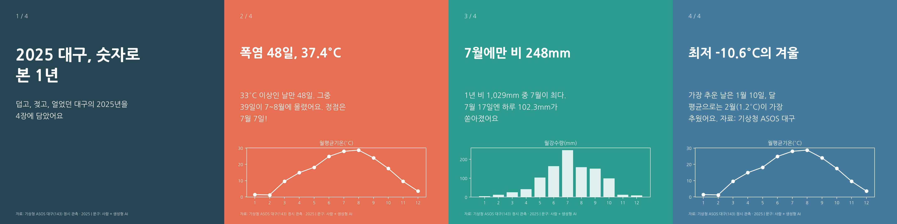

<callout icon="📒" color="blue_bg">
<b>워크북 2 — 검증·편집, 카드뉴스 제작, 블라인드 비교 (9~12단계 · 78~120분)</b>

- 학생: [학생 워크북 Colab](https://colab.research.google.com/drive/1ulJkM1g6ojBR5qX7Bq07hVjhoG7KRaZg) → `파일 → Drive에 사본 저장` 후 실행
- 강의자: [강의자 시연 완성본 Colab](https://colab.research.google.com/drive/1cGn8WJHPVDJKQoneIynDVqGpF-NYEOU3) (실행 결과·예시 답 저장본)
- 두 노트북은 서로 다른 파일입니다. 강의자가 실행해도 학생 노트북에는 영향이 없습니다.
- 이 페이지의 코드는 노트북 코드와 같습니다. '실행 결과 예시'는 오프라인 예비 응답 기준이며, 실제 AI 응답은 실행할 때마다 달라집니다.
</callout>

<callout icon="🧑‍🏫" color="gray_bg">
<b>개별 · 78분 (14분)</b> 9단계 편집 → 10단계 카드. 순회하면서 '숫자 없는 오류'를 찾았는지 확인합니다.
</callout>

## 9단계. ✍️ 사람이 검증·편집하기 (8분)
AI 글을 그대로 쓰지 않습니다. v4를 출발점으로 **사실표와 한 줄씩 대조**하며 고칩니다.

**점검 순서**
1. 숫자 점검표의 ✘ 숫자 → 계산이 맞으면 두기, 근거가 없으면 지우기
2. **숫자가 없는 문장**도 확인 — 예: "가장 추운 달은 1월" (자동 검사로 못 잡음!)
3. 제목 15자, 본문 60자 이내
4. 카드4에 출처가 있는지

아래 `FINAL_TEXT`를 고칩니다. 비워 두면 v4를 그대로 씁니다.

✅ **확인:** `→ 숫자 N개 중 사실표에 없는 숫자 M개`와 `최종본: 카드 4장`. 남은 ✘ 숫자는 모두 본인이 확인한 계산값이어야 합니다(완성본 예시: 39 하나).

```python
print('── v4 원문(복사해서 고치세요) ──')
print(responses.get('v4', ''))

FINAL_TEXT = """"""   # ✍️ 고친 최종본

final_text = FINAL_TEXT.strip() or responses.get('v4', '')
final_cards = parse_cards(final_text)
print()
check_numbers(final_text)
print(f'최종본: 카드 {len(final_cards)}장')
display(pd.DataFrame(final_cards, index=[f'카드{i}' for i in range(1, len(final_cards) + 1)]))
```

<toggle>
✍️ 강의자 예시 답 (완성본 노트북의 값)

```python
print('── v4 원문(복사해서 고치세요) ──')
print(responses.get('v4', ''))

FINAL_TEXT = """[카드1] 제목: 2025 대구, 숫자로 본 1년 / 본문: 덥고, 젖고, 얼었던 대구의 2025년을 4장에 담았어요
[카드2] 제목: 폭염 48일, 37.4°C / 본문: 33°C 이상인 날만 48일. 그중 39일이 7~8월에 몰렸어요. 정점은 7월 7일!
[카드3] 제목: 7월에만 비 248mm / 본문: 1년 비 1,029mm 중 7월이 최다. 7월 17일엔 하루 102.3mm가 쏟아졌어요
[카드4] 제목: 최저 -10.6°C의 겨울 / 본문: 가장 추운 날은 1월 10일, 달 평균으로는 2월(1.2°C)이 가장 추웠어요. 자료: 기상청 ASOS 대구"""   # ✍️ 고친 최종본

final_text = FINAL_TEXT.strip() or responses.get('v4', '')
final_cards = parse_cards(final_text)
print()
check_numbers(final_text)
print(f'최종본: 카드 {len(final_cards)}장')
display(pd.DataFrame(final_cards, index=[f'카드{i}' for i in range(1, len(final_cards) + 1)]))
```
</toggle>

<b>실행 결과 예시</b> (강의자 완성본, 오프라인 예비 응답 기준)

```plain text
── v4 원문(복사해서 고치세요) ──
[카드1] 제목: 2025 대구, 숫자로 본 1년 / 본문: 덥고, 젖고, 얼었던 대구의 2025년을 4장에 담았어요
[카드2] 제목: 폭염 48일, 37.4°C / 본문: 33°C를 넘긴 날만 48일. 그중 39일이 7~8월에 몰렸어요. 정점은 7월 7일!
[카드3] 제목: 7월에만 비 248mm / 본문: 1년 비 1,029mm 중 7월이 최다. 7월 17일엔 하루 102.3mm가 쏟아졌어요
[카드4] 제목: 최저 -10.6°C의 겨울 / 본문: 1월 10일이 가장 추웠고, 가장 추운 달도 1월이었어요. 자료: 기상청 ASOS 대구

✔ 사실표에 있는 숫자 : 2,025, 1, 2,025, 48, 37.4, 33, 48, 7, 8, 7, 7, 7, 248, 1, 1,029, 7, 7, 17, 102.3, 10.6, 1, 10, 2, 1.2
✘ 사실표에 없는 숫자 : 39
→ 숫자 25개 중 사실표에 없는 숫자 1개
최종본: 카드 4장
                    제목                                                 본문
카드1  2025 대구, 숫자로 본 1년                    덥고, 젖고, 얼었던 대구의 2025년을 4장에 담았어요
카드2     폭염 48일, 37.4°C    33°C 이상인 날만 48일. 그중 39일이 7~8월에 몰렸어요. 정점은 7월 7일!
카드3       7월에만 비 248mm   1년 비 1,029mm 중 7월이 최다. 7월 17일엔 하루 102.3mm가 쏟아졌어요
카드4     최저 -10.6°C의 겨울  가장 추운 날은 1월 10일, 달 평균으로는 2월(1.2°C)이 가장 추웠어요. 자...
```

## 10단계. 카드뉴스 PNG 4장 만들기 (5분)
최종 문구로 **1080×1080 인스타그램 카드**를 만듭니다. 본문에 `비`·`강수`가 있으면 월강수량 막대, `더위`·`폭염`·`°C`가 있으면 월평균기온 선을 카드 아래에 자동으로 넣습니다. 모든 카드 아래에 출처가 들어갑니다.

| 코드 | 하는 일 |
|---|---|
| `plt.figure(figsize=(6, 6))` + `dpi=180` | 6인치 × 180 = 1080픽셀 정사각형 |
| `textwrap.fill(글, 너비)` | 긴 글을 여러 줄로 나누기 |
| `fig.add_axes([...])` | 카드 안 원하는 위치에 작은 그래프 넣기 |

✅ **확인:** `card_1.png` ~ `card_4.png` 4장 저장, 아래에 미리보기.

```python
PALETTE = ['#264653', '#e76f51', '#2a9d8f', '#457b9d']
SOURCE = '자료: 기상청 ASOS 대구(143) 정시 관측 · 2025 | 문구: 사람 + 생성형 AI'

def draw_card(i, card):
    fig = plt.figure(figsize=(6, 6), dpi=180)
    fig.patch.set_facecolor(PALETTE[i % 4])
    fig.text(0.07, 0.92, f'{i + 1} / 4', color='white', fontsize=11, alpha=0.8)
    size = 30 if i == 0 else 24
    fig.text(0.07, 0.80, textwrap.fill(card['제목'], 12 if i == 0 else 14), color='white',
             fontsize=size, fontweight='bold', va='top', linespacing=1.3)
    fig.text(0.07, 0.56 if i == 0 else 0.60, textwrap.fill(card['본문'], 22), color='white',
             fontsize=14, va='top', linespacing=1.6)
    body = card['제목'] + card['본문']
    if i > 0 and ('비' in body or '강수' in body):
        ax = fig.add_axes([0.1, 0.12, 0.8, 0.22])
        ax.bar(month.index, month['강수량'], color='white', alpha=0.85)
        ax.set_title('월강수량(mm)', color='white', fontsize=10)
    elif i > 0 and any(k in body for k in ['더위', '폭염', '더운', '°C']):
        ax = fig.add_axes([0.1, 0.12, 0.8, 0.22])
        ax.plot(month.index, month['평균기온'], color='white', marker='o')
        ax.set_title('월평균기온(°C)', color='white', fontsize=10)
    else:
        ax = None
    if ax is not None:
        ax.set_facecolor('none')
        ax.tick_params(colors='white', labelsize=8)
        ax.set_xticks(range(1, 13))
        for s in ax.spines.values():
            s.set_color('white')
    fig.text(0.07, 0.04, SOURCE, color='white', fontsize=7, alpha=0.85)
    p = OUT / f'card_{i + 1}.png'
    fig.savefig(p, dpi=180, facecolor=fig.get_facecolor())
    plt.close(fig)
    return p

if len(final_cards) == 4:
    card_files = [draw_card(i, c) for i, c in enumerate(final_cards)]
    fig, axes = plt.subplots(1, 4, figsize=(14, 3.8))
    for ax, p in zip(axes, card_files):
        ax.imshow(plt.imread(p)); ax.axis('off')
    plt.tight_layout(); plt.show()
    print('저장:', ', '.join(p.name for p in card_files))
else:
    print('⚠️ 카드가 4장이 아닙니다. 9단계 FINAL_TEXT 형식을 확인하세요.')
```

<b>실행 결과 예시</b> (강의자 완성본, 오프라인 예비 응답 기준)

```plain text
저장: card_1.png, card_2.png, card_3.png, card_4.png
```



<callout icon="🚩" color="red_bg">
<b>CP5 · 92분</b> `저장: card_1.png, card_2.png, card_3.png, card_4.png` + 미리보기 4장. 카드가 4장이 아니면 9단계 형식을 확인합니다.
</callout>

<callout icon="🧑‍🏫" color="gray_bg">
<b>짝 활동 · 92분</b> 노션 §7로 돌아가 진행합니다. 짝과 노트북 화면을 바꿔 봅니다.
</callout>

## 11단계. 블라인드 비교 — 짝은 구별할 수 있을까? (10분)
3단계 **사람 버전**과 7단계 **AI v4 원문**(편집 전)을 A·B로 섞어 보여 줍니다. 어느 쪽이 사람인지 화면에 나오지 않습니다.

**진행 방법**
1. 아래 셀을 실행하고 화면을 짝에게 보여 줍니다.
2. 짝이 ① 어느 쪽이 AI인지 고르고 ② 세 기준(1~5점)으로 평가합니다 → 11-1 칸에 기록
3. 11-2 셀을 실행해 정답을 공개합니다.

✅ **확인:** `A`와 `B` 두 글이 출력됩니다(사람 버전을 안 썼다면 ⚠️ 안내).

```python
rng = random.Random(sum(map(ord, STUDENT_ID)))       # 학번마다 순서가 다름
order = rng.sample(['사람', 'AI'], 2)                   # order[0] = A, order[1] = B
texts = {'사람': human_cards, 'AI': parse_cards(responses.get('v4', ''))}
if len(human_cards) == 4:
    for label, who in zip('AB', order):
        print(f'━━━━━━━━ {label} ━━━━━━━━')
        for k, cd in enumerate(texts[who], 1):
            print(f'  {k}. {cd["제목"]} — {cd["본문"]}')
        print()
else:
    print('⚠️ 3단계 사람 버전을 먼저 작성하세요.')
```

<b>실행 결과 예시</b> (강의자 완성본, 오프라인 예비 응답 기준)

```plain text
━━━━━━━━ A ━━━━━━━━
  1. 2025 대구, 숫자로 본 1년 — 덥고, 젖고, 얼었던 대구의 2025년을 4장에 담았어요
  2. 폭염 48일, 37.4°C — 33°C를 넘긴 날만 48일. 그중 39일이 7~8월에 몰렸어요. 정점은 7월 7일!
  3. 7월에만 비 248mm — 1년 비 1,029mm 중 7월이 최다. 7월 17일엔 하루 102.3mm가 쏟아졌어요
  4. 최저 -10.6°C의 겨울 — 1월 10일이 가장 추웠고, 가장 추운 달도 1월이었어요. 자료: 기상청 ASOS 대구

━━━━━━━━ B ━━━━━━━━
  1. 2025 대구, 이렇게 더웠다 — 기상청 관측자료로 돌아보는 대구의 1년
  2. 폭염 48일 — 최고 33°C 이상인 날이 48일. 7월 7일엔 37.4°C까지 올랐다
  3. 비는 7월에 몰렸다 — 1년 1,029mm 중 248mm가 7월. 7월 17일엔 하루 102.3mm
  4. 겨울은 2월이 더 추웠다 — 최저 -10.6°C는 1월 10일, 월평균은 2월이 1.2°C로 가장 낮았다. 자료: 기상청
```

### 11-1. ✍️ 짝의 판단 기록
`GUESS`에 짝이 AI라고 고른 쪽(`'A'` 또는 `'B'`), `SCORES`에 1~5점을 적습니다.

| 기준 | 질문 |
|---|---|
| 정확성 | 숫자와 내용이 믿을 만한가? (사실표 참고) |
| 읽고 싶음 | 넘겨 보고 싶은가? |
| 행동 유도 | 저장·공유하고 싶은가? |

```python
GUESS = ''      # ✍️ 짝이 AI라고 고른 쪽: 'A' 또는 'B'
SCORES = {"A": {"정확성": 0, "읽고 싶음": 0, "행동 유도": 0}, "B": {"정확성": 0, "읽고 싶음": 0, "행동 유도": 0}}   # ✍️ 1~5점
```

<toggle>
✍️ 강의자 예시 답 (완성본 노트북의 값)

```python
GUESS = 'B'      # ✍️ 짝이 AI라고 고른 쪽: 'A' 또는 'B'
SCORES = {"A": {"정확성": 4, "읽고 싶음": 5, "행동 유도": 4}, "B": {"정확성": 5, "읽고 싶음": 3, "행동 유도": 3}}   # ✍️ 1~5점
```
</toggle>

### 11-2. 정답 공개
✅ **확인:** 실제 순서, 짝이 맞혔는지, 사람/AI별 점수 표

```python
blind = {'order': {'A': order[0], 'B': order[1]}, 'guess': GUESS, 'scores': SCORES}
if len(human_cards) == 4 and GUESS in ('A', 'B'):
    ai_label = 'A' if order[0] == 'AI' else 'B'
    print(f'정답: A = {order[0]}, B = {order[1]}')
    print('짝의 판단:', '맞힘 ✔' if GUESS == ai_label else '못 맞힘 ✘ (AI 글을 사람 글로 봄)')
    score_table = pd.DataFrame({order[0]: SCORES['A'], order[1]: SCORES['B']}).T
    display(score_table)
    blind['correct'] = GUESS == ai_label
else:
    print('⚠️ 사람 버전과 GUESS를 입력한 뒤 다시 실행하세요.')
_ = (OUT / 'blind_eval.json').write_text(json.dumps(blind, ensure_ascii=False, indent=2), encoding='utf-8')
```

<b>실행 결과 예시</b> (강의자 완성본, 오프라인 예비 응답 기준)

```plain text
정답: A = AI, B = 사람
짝의 판단: 못 맞힘 ✘ (AI 글을 사람 글로 봄)
    정확성  읽고 싶음  행동 유도
AI    4      5      4
사람    5      3      3
```

<callout icon="🧑‍🏫" color="gray_bg">
<b>개별 · 110분</b> 남은 시간에 Q1~Q5를 쓰고 ZIP을 만듭니다. 못 끝낸 학생은 과제로 이어 갑니다.
</callout>

## 12단계. ✍️ 기록과 제출 (5분)
Q1~Q5에 답하고 마지막 셀을 실행하면 제출 ZIP이 만들어집니다. **Q5 AI 사용 기록**은 콘텐츠를 공개할 때 밝혀야 하는 정보입니다.

```python
ANSWERS = {
    "Q1_v1에서_사실표에_없는_숫자와_그_출처": "",
    "Q2_가장_효과가_컸던_프롬프트_요소와_이유": "",
    "Q3_숫자_검사를_통과했는데도_사람이_고친_부분": "",
    "Q4_블라인드_비교에서_알게_된_점": "",
    "Q5_AI_사용_기록": ""
}   # ✍️
```

<toggle>
✍️ 강의자 예시 답 (완성본 노트북의 값)

```python
ANSWERS = {
    "Q1_v1에서_사실표에_없는_숫자와_그_출처": "8개(16.1, 39.8, 41, 30, 520, 1,180, 12.3, 2026). '8월 2일'처럼 사실표에 있는 숫자(8, 2)로 이루어진 틀린 날짜는 걸러지지 않았다. 데이터를 주지 않았는데도 AI가 '대구는 덥다'는 일반적인 패턴으로 그럴듯한 숫자를 지어냈다.",
    "Q2_가장_효과가_컸던_프롬프트_요소와_이유": "v2의 '근거 데이터'. 사실표를 넣자 사실표에 없는 숫자가 8개에서 0개로 줄었다. 형식은 v3의 출력 형식 지정, 문체는 v4의 예시가 가장 크게 바꿨다.",
    "Q3_숫자_검사를_통과했는데도_사람이_고친_부분": "v4가 '가장 추운 달은 1월'이라고 썼는데 사실표는 2월(평균 1.2°C)이다. 숫자가 없는 문장이라 자동 검사로는 잡히지 않았다. '39일'은 사실표에 없다고 표시됐지만 18+21=39로 맞는 계산이라 그대로 두었다.",
    "Q4_블라인드_비교에서_알게_된_점": "짝은 사람 글(B)을 AI로 골라 맞히지 못했다. AI 글이 '읽고 싶음' 점수는 더 높았지만 정확성은 사람 글이 높았다. 문장력은 AI가, 사실 확인은 사람이 강했다.",
    "Q5_AI_사용_기록": "Colab 내장 Gemini(google.colab.ai, 기본 모델), 2026-12-03. v1~v4 카드뉴스 초안 생성에 사용. 최종 문구는 사람이 사실표와 대조해 수정했다."
}   # ✍️
```
</toggle>

✅ **확인:** `제출 파일: week13_<학번>.zip` 과 포함 파일 목록. Colab 왼쪽 📁에서 내려받아 제출합니다.

```python
log = {'student': STUDENT_ID, 'time': datetime.datetime.now().isoformat(timespec='minutes'),
       'facts': fact_rows, 'human_text': HUMAN_TEXT, 'prompts': prompts,
       'responses': responses, 'sources': sources, 'final_text': final_text, 'answers': ANSWERS}
_ = (OUT / 'week13_log.json').write_text(json.dumps(log, ensure_ascii=False, indent=2, default=str), encoding='utf-8')
empty = [k for k, v in ANSWERS.items() if not str(v).strip()]
if empty:
    print('⚠️ 아직 비어 있는 답:', ', '.join(empty))
zip_name = shutil.make_archive(f'week13_{STUDENT_ID}', 'zip', OUT)
print('제출 파일:', Path(zip_name).name)
print('포함:', ', '.join(sorted(p.name for p in OUT.iterdir())))
```

<b>실행 결과 예시</b> (강의자 완성본, 오프라인 예비 응답 기준)

```plain text
제출 파일: week13_강의자예시.zip
포함: blind_eval.json, card_1.png, card_2.png, card_3.png, card_4.png, compare.csv, facts.csv, fig_compare.png, fig_monthly.png, week13_log.json
```
